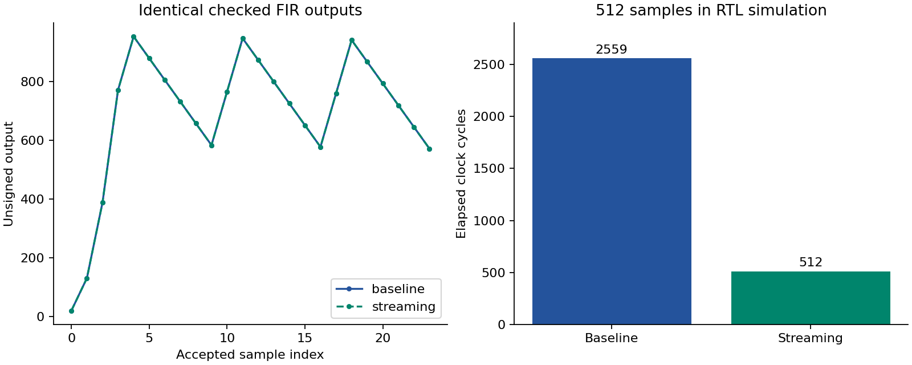
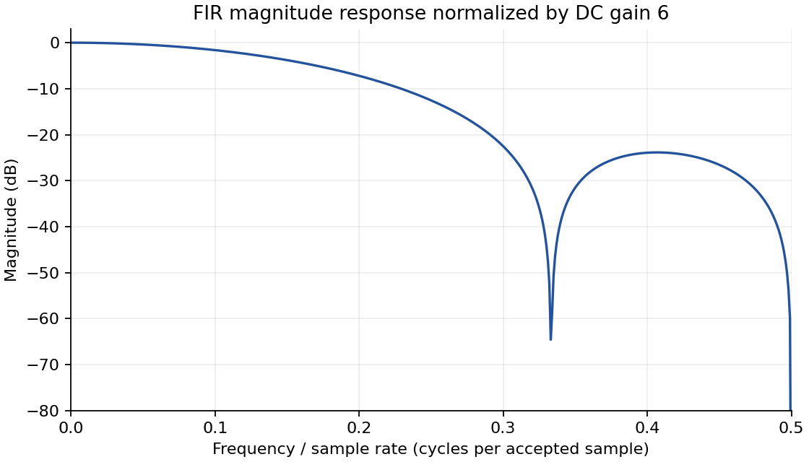

# Verified FIR filter architectures in VHDL

An 8-bit, four-tap FIR filter with a preserved coursework implementation and a
separate streaming implementation. Both compute the same exact unsigned result:

```text
y[n] = x[n] + 2*x[n-1] + 2*x[n-2] + x[n-3]
```

The project demonstrates hardware description, pipelining, arithmetic widths,
interface design, automated verification and reproducible performance comparison.
It runs on a computer using GHDL; no FPGA board, GPU, dataset or ML training is needed.

**Current status:** reproduced on Windows with GHDL 6.0.0 and Google Colab Linux
with GHDL 4.1.0. The returned Colab archive, executed notebook and raw waveforms
were independently reviewed. Vivado synthesis, physical timing, power and board
execution remain unverified.

## What was measured

Each original Windows and Colab run passed **22 Python tests** and checked **5,272 VHDL outputs**:
1,620 from the baseline and 3,652 from the streaming design, with zero arithmetic
mismatches. It includes 6,000 seeded random stimulus cycles, directed numerical
tests, reset during outstanding work, invalid-input gaps and busy-time requests.
The Colab review additionally recomputed every output directly from accepted
inputs in the VCD waveform, independently of the testbench's expected-value column.
After adding that review tooling, the local suite passed **38 Python tests**
and repeated the same 5272-output VHDL simulation. The 22-test count above is
the historical suite actually executed in the submitted Colab session.

| RTL architecture | Input interval | Latency | 512-sample block |
|---|---:|---:|---:|
| Preserved five-state FSM | 5 cycles | 4 cycles | 2,559 cycles |
| Symmetric streaming pipeline | 1 cycle | 1 cycle | 512 cycles |

All durations count elapsed rising-edge intervals. The block measurement starts
at the first accepted input and ends at the last valid output. Both benchmarks
use the same 512 input values and produce identical output values. At a common
clock, the new pipeline has **5x the steady-state sample acceptance rate**.
This does not establish a fivefold physical clock speedup, lower FPGA area or
lower power consumption. Those require separate implementation evidence.



Inspect [measured metrics](results/summary/metrics.json), the
[benchmark](results/summary/benchmark.csv), [run summary](results/summary/evaluation_report.md),
and [test log](results/summary/python_tests.txt). Full per-output traces, VCD waveforms,
source snapshots and checksums are exported by every run.

The [Colab review](docs/COLAB_RESULTS_REVIEW.md) links the unchanged submitted
[result archive](results/colab-2026-10-21/results_for_review.zip),
[executed notebook](results/colab-2026-10-21/executed_notebook.ipynb),
[environment](results/colab-2026-10-21/environment.json), and
[independent review](results/colab-2026-10-21/independent_review.json).
The README figures were generated locally; optional Colab plotting was disabled.

## Run it

The prepared Windows working copy includes the portable simulator in an ignored
local tooling directory. Open PowerShell in the project folder:

```powershell
powershell -ExecutionPolicy Bypass -File run_simulation.ps1
```

For a fresh Windows copy, install Python 3.10+ and run
`scripts/setup_ghdl.ps1` first. If `python` and `ghdl` are on PATH, the portable command is:

```text
python scripts/run_verification.py
```

On Ubuntu, install `ghdl` and `python3`, then use `python3` for that command.
Each run writes a new directory and produces `results_for_review.zip`.
See [full setup instructions](docs/RUNNING.md) for Windows paths, waveforms,
optional figures, and the Google Colab alternative.

## Architecture and numerical contract

- Input: unsigned 8-bit values, 0–255. Coefficients are fixed at `[1, 2, 2, 1]`.
- Output: unnormalized exact integer sum, maximum 1530, zero-extended to 18 bits.
- Reset: active-low asynchronous reset, clearing history and pending work.
- Baseline: input is accepted only while idle; requests while busy are ignored.
- Streaming: pair sums exploit symmetry; a left shift implements multiplication
  by two. It accepts a valid input each cycle and returns the result one edge later.
- Streaming `StrobeOut` is valid on **each** asserted cycle, including consecutive
  cycles. `Busy` stays low. There is no output backpressure.

The DC gain is six; dividing by six is only a plotting choice, not hardware behavior.
See [architecture and handshake details](docs/ARCHITECTURE.md).



## Repository guide

| Path | Purpose |
|---|---|
| `rtl/fir_filter.vhd` | Original RTL recovered without logic edits |
| `rtl/fir_filter_streaming.vhd` | New fixed-coefficient pipelined architecture |
| `tb/tb_fir_filter_original.vhd` | Original six-sample stimulus, preserved |
| `tb/tb_fir_verification.vhd` | Assertions, independent integer scoreboard and cycle measurements |
| `scripts/fir_reference.py` | Exact Python mathematical reference |
| `scripts/run_verification.py` | Simulator execution, validation and evidence export |
| `tests/` | Numerical reference, archive integrity, CSV and raw-waveform review tests |
| `scripts/review_results.py` | Validate a returned archive without executing its source |
| `scripts/verify_waveform.py` | Recompute arithmetic and protocol behavior from VCD inputs |
| `notebooks/01_fir_simulation.ipynb` | CPU Colab execution and result download |
| `scripts/vivado_synth.tcl` | Optional constrained, out-of-context synthesis comparison |
| `.github/workflows/verify.yml` | Linux verification workflow; inspect its latest run in Actions |
| `PROJECT_AUDIT.md` | Original evidence, issues, measurements and priorities |
| `provenance/` | Source hashes, extraction record and contributor credit |

Create a source bundle for Colab with `python scripts/package_source.py`. The
bundle excludes original reports, student identifiers, downloaded tools and
local intermediate files. It also excludes the full historical Colab evidence
directory; those review links are available in the full repository. Upload the
source ZIP in the notebook when prompted.

## Interpretation and next steps

The original report's **2050 cycles, 220 area units and 4.4 W** describe an
explicit theoretical resource model. They are not measurements of the baseline
FSM or the new streaming pipeline. Reported historical synthesis utilization is
not independently reproduced here. The specialization keeps the FIR equation
but changes the architecture and does not prove the original minimum-area claim.

The next useful experiment is a same-device synthesis comparison of LUTs,
registers, DSPs and timing using [the Vivado guide](docs/VIVADO.md). Then consider
a ready/valid interface with downstream stalls, or signed fixed-point samples
with documented rounding and overflow behavior. A board demonstration is optional
and requires a board-specific interface, pin constraints and physical tests.

The project demonstrates verified digital design and evidence of the engineering
tradeoffs between an FSM-based baseline and a streaming implementation.

## Attribution

The original EE-8208 report is jointly authored by **Mohammad Albatayneh and
Ashvin Selvakumar**, Toronto Metropolitan University, August 2026. The original
sources are preserved separately from new development. Individual contribution
boundaries are not inferred. See [source provenance](provenance/README.md).
No redistribution license is asserted on behalf of both authors.

Tool references: [GHDL simulation workflow](https://ghdl.github.io/ghdl/quick_start/simulation/index.html),
[GHDL 6.0.0 release](https://github.com/ghdl/ghdl/releases/tag/v6.0.0),
[AMD Vivado synthesis command](https://docs.amd.com/r/2023.2-English/ug835-vivado-tcl-commands/synth_design).
